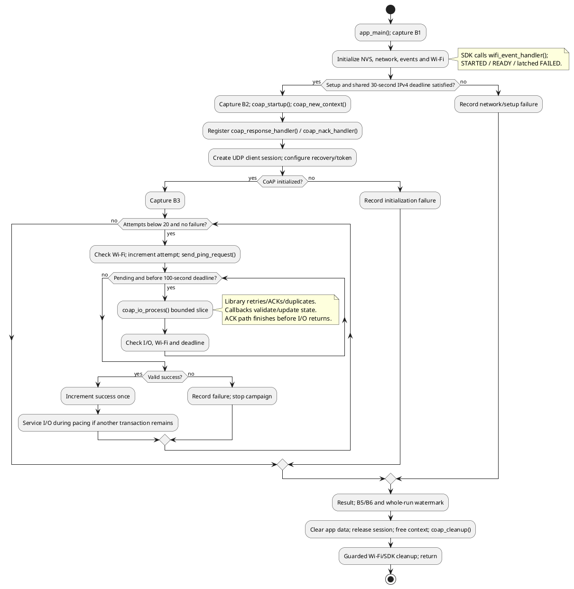
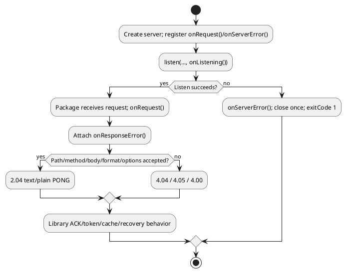

# Approved Phase 2 G2 implementation baseline

Approval provenance: user explicitly approved the complete G2 design and subsequent final-ACK, callback-return and G3 sequencing clarifications. G3-A accepted at aad119d4a980b37e510940e37a85b835a1630717; subsequent G3-B instrumentation/build work authorized. G3-C fixture implementation authorized; G4 remains unauthorized. This checked-in record summarizes that approved contract alongside exact actual registries; it does not replace or broaden the conversation approval.

## Scope and stage boundary

ESP32-S3/ESP-IDF 5.5.4; official espressif/coap ==4.3.5~8; Node coap ==1.6.0; unicast unsecured UDP; CON POST /coap-test; exact PING/PONG; 20 logical attempts, one pending transaction; standard library recovery. G3-A implements integration, source/config/dependency records, essential heap/stack logs and clean build. G3-B full instrumentation and separate primary/scoped build evidence are now authorized. G3-C fixture/dev dependency implementation authorized; all G4 execution remains unauthorized.

Exactly five C functions and four Node callbacks; actual signatures/callers/APIs/success/failure are in FUNCTION_REGISTRY.md. Variables/types/storage/defaults in VARIABLE_REGISTRY.md. Wire scope in PROTOCOL_REGISTRY.md. No application task, extra helper, adapter or upstream patch. Main owns context/session/transaction; SDK event handler only event bits. Borrowed response pointers are not retained. Unsent PDU deleted locally; coap_send consumes submitted PDU even on failure.

## Execution and errors

Preserve Phase 1 NVS/network/event/Wi-Fi setup, one connection attempt after STARTED, shared wrap-safe 30-second deadline, FAILED latch, guarded cleanup. No NVS auto-erase/reconnect. Set up context/client-only UDP session, callbacks, block mode 0, max token 8, library recovery 2s/1.5/4/NSTART1. PRNG seed normalized for four-byte tokens over the short campaign. Request uses new_pdu and ordered token/URI-Path/Content-Format/data operations. Main counts logical attempts once; bounded I/O services reliability and callbacks; 100-second application ceiling includes ACK-only waiting. Success requires token, expected ACK MID where applicable, code 2.04, Content-Format 0, no Observe/blocks, exact PONG, READY/no FAILED. Only main increments success once. Continue I/O while pacing for 1 second. Fail on relevant NACK, I/O, deadline, invalid matching response or Wi-Fi. Wrong/stale token never succeeds. No independent retry layer.

Final-response clarification: callback sets SUCCEEDED and returns OK; library invokes ACK-send synchronously before enclosing coap_io_process returns. Main waits for that return before counting and cleanup, even on transaction 20. ACK attempt is not delivery proof. FAIL deliberately requests RST for rejected CON/NON; no RST for ACK response. Parser-rejected malformed packets may never reach callback. Cleanup does not occur in callbacks.

Measurements precede cleanup. Clear borrowed app data, release session, free context, cleanup library, then retained guarded Wi-Fi/SDK teardown. Warnings retain historical ownership-safe behavior.

## Dependencies/configuration

Managed component source unmodified, lockfiles tracked. Main headers: stdint.h, stdbool.h, stddef.h, string.h, inttypes.h; lwip/inet.h; freertos/FreeRTOS.h, task.h, event_groups.h; esp_event.h, esp_netif.h, esp_wifi.h, esp_wifi_default.h, esp_log.h, esp_err.h, esp_heap_caps.h, nvs_flash.h; coap3/coap.h; private wifi_credentials.h. Explicit SDK components esp_wifi, esp_event, esp_netif, nvs_flash, lwip, freertos, log, esp_common, heap; managed component espressif__coap (requires lwip/mbedtls).

Copy committed effective non-secret Phase 1 config into phase-specific defaults and append approved CoAP settings: client on, server/TCP/PSK/PKI/OSCORE/WebSockets/Q-Block/async/thread-safe/debug/Observe persistence off, internal allocation. Proxy gated off. Preserve global Mbed TLS and all pre-existing settings; no DTLS/security session. Configured app stack4096, CPU160, tick100, debug optimization, PSRAM disabled, flash16MB QIO40, single1MiB partition.

Node production API: createServer(options), request/error events, listen, close, public request fields/normalized headers/options (raw options are checked because Buffer-valued options may be absent from normalized headers), response setOption/end/error. Four callbacks only; no source-private package APIs. Port56830 or validated TRIAL_COAP_PORT; udp4/proxyfalse/cache65536/piggyback50ms/ACK-for-NONfalse. Response 2.04/PONG or 4.04 path,4.05 method,4.00 invalid payload/format/excluded options. Upstream package can process some options before application handler; no claim of global removal of its unused features. coap-oscore/cbor are mandatory installed transitive packages, unused. Direct test codec/fixture are now implemented under G3-C; no live-network execution authorized.

## Measurement and testing

RESOURCE_BASELINE.md defines implemented primary/scoped checkpoints, current build evidence, historical missing B0/B3/B4 and original earlier-image section provenance. No historical UDP edits/control build. G3-B implements instrumentation and section/component build attribution; all runtime primary/scoped campaigns, monitor allocation and task observations await G4. Test IDs P2-01..29 and execution boundaries are in MANUAL_TEST_PROCEDURE.md; no G4 execution here. Future tests require exact expected/actual results, logs, artifact IDs and capture evidence, including final separate-CON ACK. Communication compilation is not runtime feasibility proof.

Beken review maps sockets/I/O wait/ticks/allocator/random/build/task facilities when exact chip/SDK is supplied. No Beken implementation or ESP32-to-Beken size extrapolation. Existing Mbed TLS compatibility is future consideration only. Exclude architecture revisit, presence notification, pending message, MQTT handover, security, production heartbeat/adaptive intervals, push, Observe/discovery/blocks/multicast/proxy, firmware/large transfer, registration, Redis, production recovery and frameworks.

## Approved main flow (PlantUML)

## Approved Node flow (PlantUML)

## Review sequence

G3-A source/build review and explicit acceptance before G3-B. G3-B review before G3-C. G4 separate authorization. No automatic advancement. Deviations require explicit approval. G3-A commit/push was separately authorized and completed as aad119d4a980b37e510940e37a85b835a1630717. G3-B was separately authorized for commit/push and accepted as c146cb2353feb5cc467f85968fb9f6546fb1f607. G3-C was separately committed/pushed and accepted as7dbe6f2298fbdcbeee34669c097ca55648b22f71. The subsequent watchdog amendment remains uncommitted pending review.

## G3-C implementation record

G3-B accepted at c146cb2353feb5cc467f85968fb9f6546fb1f607. Approved host fixture now implemented with exactly main, onFrontMessage, onBackMessage, sendDatagram, sendScheduledDatagram, onSendComplete, onSocketError, onListening, onTimeout, onSignal and finish. Actual contracts/state/modes are in the registries. No new ESP32/server function or runtime communication change. Direct test-only coap-packet1.1.1 pinned; no resolved version change. Usage and mode-specific synthetic limitations recorded in MANUAL_TEST_PROCEDURE.md. Source validated with mock sockets/timers; G4 still unauthorized. Arithmetic request-size prediction corrected23 ->24 without changing packet definition. No design deviation required.

## Approved G4 clarification/watchdog amendment

G3-C accepted at7dbe6f2298fbdcbeee34669c097ca55648b22f71. User separately approved only FIXTURE_TIMEOUT_MS120000 ->180000 and documentation/mocked validation; all other source unchanged. First-request<=60s is an operator setup rule, not fixture logic. Physical/loopback successful capture verification is prerequisite; availability and actual capture not yet verified. Exactly one immutable authoritative primary/scoped artifact set selected by member hashes; no silent rebuild substitution. Each run reports fixture validity, ESP actual result, overall PASS/FAIL/BLOCKED, actual packet evidence and resource validity separately. No new test IDs, protocol/security features or G4 execution. Full finalized runbook is MANUAL_TEST_PROCEDURE.md.

## Approved G4-A corrective design amendment (source-only review)

Execution baseline f7d0f1682d835611f61b658ff2e60b4607ac704d. User approved two SERVER_OPTIONS corrections after P2-06/P2-07 source investigation: add reuseAddr=false; change sendAcksForNonConfirmablePackets=false -> true. This supersedes the original ACK-for-NONfalse option description above for the current server; the four callbacks, APIs, packet contents, validation, dependencies and test matrix remain unchanged.

In installed coap 1.6.0 the latter option gates outgoing non-confirmable response packets, including ack=true piggyback replies to CON requests. Its old value suppresses the immediate response path. The new true value allows that path; actual UDP delivery remains unverified. No library fork/adapter, new function, firmware change, source-private API usage or scope expansion. Windows bind exclusivity must also be demonstrated rather than inferred. Real P2-06..08 retesting, commit and push require separate authorization. Four prior passing G4-A results remain valid; no rebuild required.
